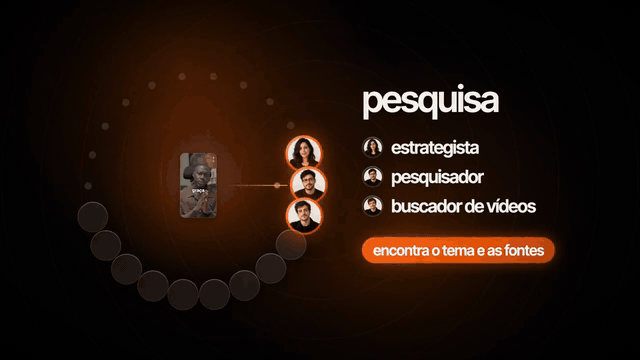
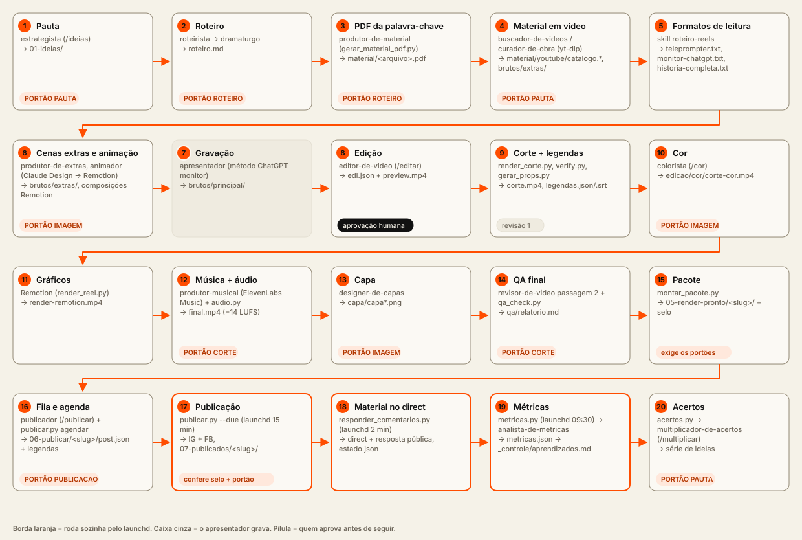
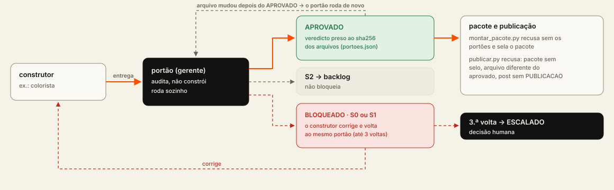
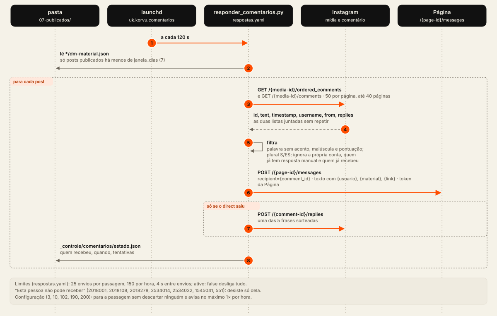
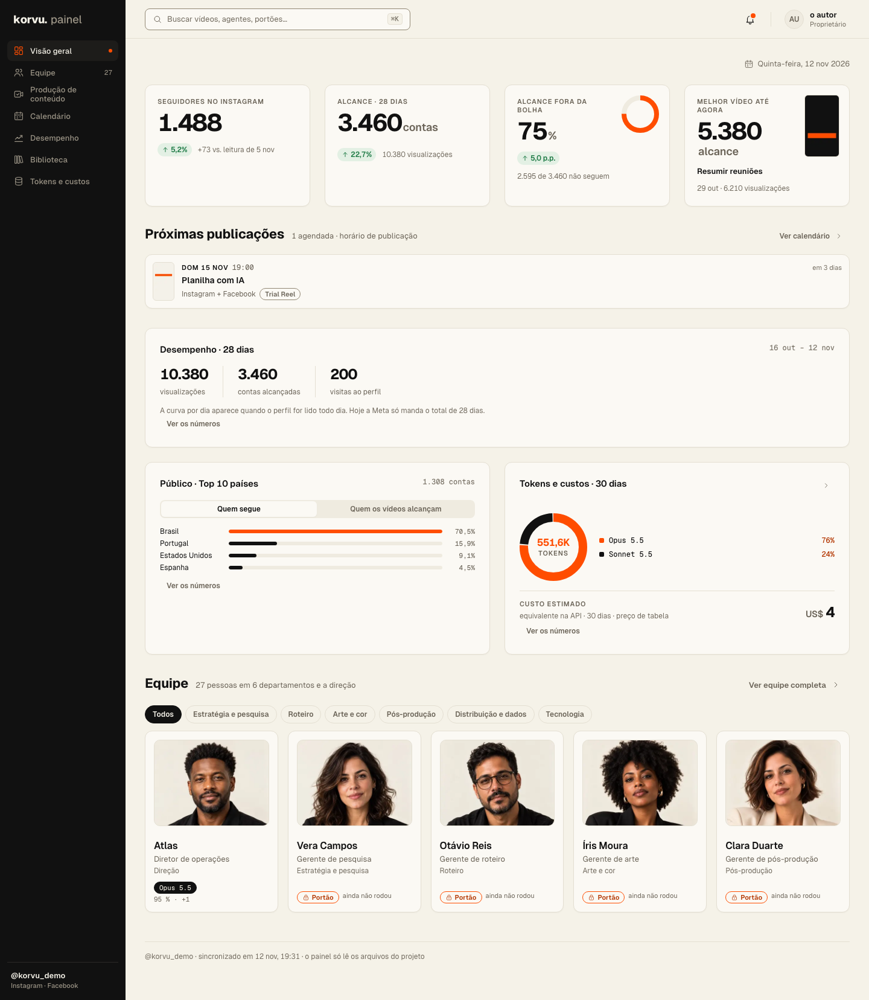
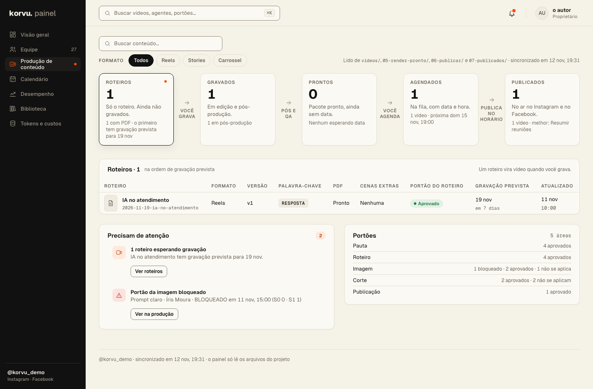
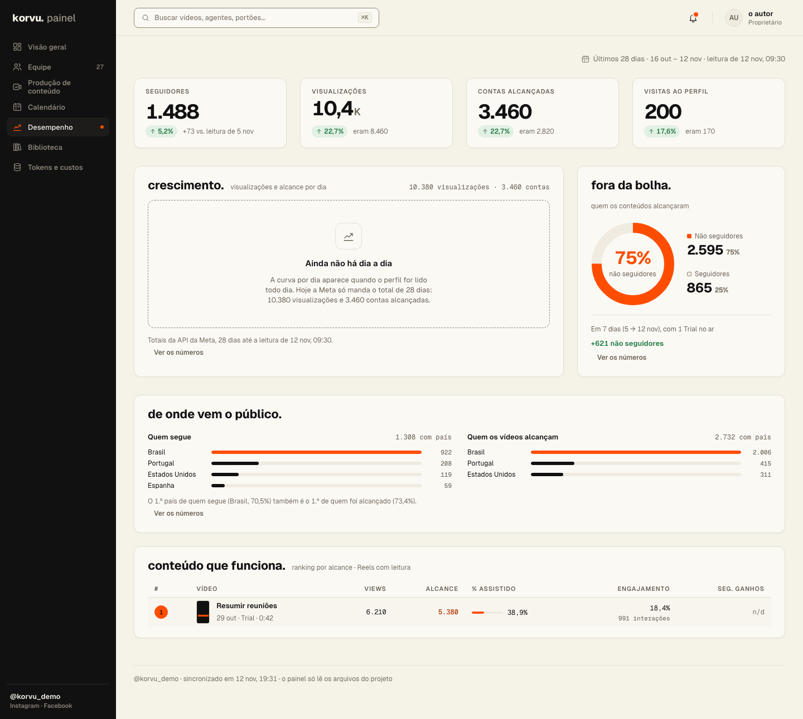
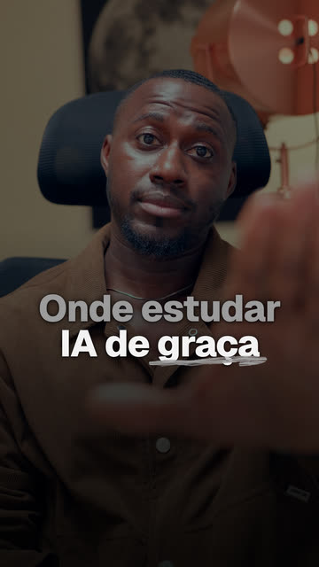
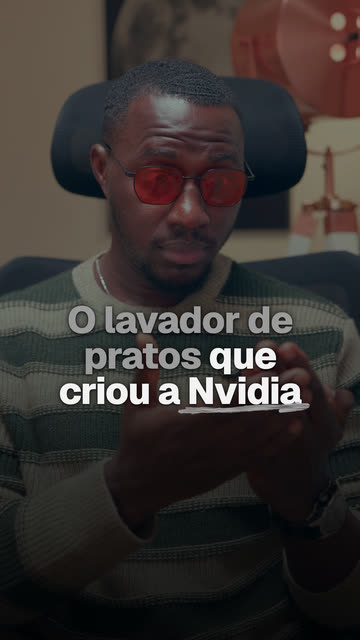
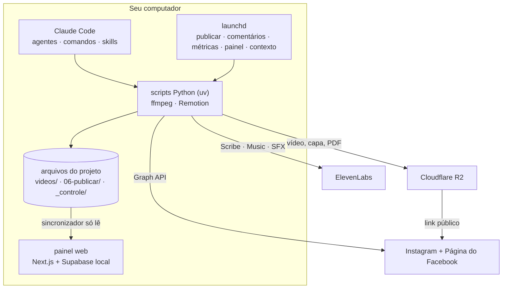

# Korvu Studio

Um estúdio de Reels sobre IA que roda no seu computador, do tema até a publicação no Instagram e no Facebook. Agentes do
Claude Code pesquisam, escrevem o roteiro, editam o vídeo e publicam. Outros agentes, os portões, conferem cada etapa
antes de ela chegar a você. Cinco dias depois, as métricas de cada vídeo voltam para o próximo roteiro.

[Ver a apresentação em vídeo (2 min)](assets/apresentacao/korvu-studio-16x9.mp4) ·
[Reels feitos com ele](#reels-feitos-com-o-estúdio) · [Instalar](#instalar-e-usar) · [Quem fez](#quem-fez) ·
[Licença MIT](LICENSE)

[](assets/apresentacao/korvu-studio-16x9.mp4)

Você chegou aqui por um destes dois motivos, e o README serve aos dois:

- Quer usar o estúdio para fazer os seus vídeos: vá para [Instalar e usar](#instalar-e-usar) e para a
  [documentação](#documentação).
- Quer aprender IA na prática com quem construiu isto: vá para [Quem fez](#quem-fez). Os Reels saem toda semana em
  [@korvu_oficial](https://www.instagram.com/korvu_oficial/), em português, para quem está começando.

## O problema que ele resolve

Um Reel bom toma um dia de trabalho. Tem o roteiro, a gravação, o corte dos erros, a cor, as legendas, a capa, a
publicação nas duas redes no horário certo, a resposta a quem comentou e, depois de alguns dias, a leitura do que
funcionou. Quem faz tudo isso sozinho acaba precisando de uma equipe.

O Korvu Studio faz o papel dessa equipe. São 29 agentes com função definida, 20 comandos, 10 skills próprias e scripts
Python que fazem o trabalho pesado com ffmpeg, Remotion e a API da Meta. Uma pessoa continua gravando. O resto anda
sozinho, com duas paradas humanas: aprovar o corte e mandar o vídeo para a fila.

## Como um vídeo anda, do tema à publicação

São 20 etapas. Cada caixa mostra o agente, o arquivo que ele entrega e o portão que confere antes de seguir. A caixa cinza
é a gravação, a pílula preta é a sua aprovação do corte e as bordas laranja são o que o `launchd` roda sozinho.



| Etapa | Quem faz | O que sai |
|---|---|---|
| Pauta e pesquisa | `estrategista`, `pesquisador-de-material`, `buscador-de-videos` | tema com fonte, dossiê, trechos de vídeo |
| Roteiro | `roteirista` e depois `dramaturgo`, que cuida da naturalidade | roteiro narrativo, teleprompter, texto para o monitor de voz |
| Material da palavra-chave | `produtor-de-material` | PDF de até 2 páginas que o direct entrega a quem comenta |
| Edição | `editor-de-video` (skill `corte-por-roteiro`) | transcrição, fala alinhada ao roteiro, melhor take de cada linha, EDL |
| Cor | `colorista` (skill `color-grading`) | V-Log para Rec.709 e o look da marca, arquivo por arquivo da câmera |
| Gráficos | Remotion (skill `legendas-animadas`, `animador`) | legendas tiradas do roteiro, títulos, cenas extras, animações, zooms |
| Áudio e música | `produtor-musical` (skill `audio-polish`, ElevenLabs Music) | voz em −14 LUFS e música que abaixa sozinha quando você fala |
| Capa | `designer-de-capas` | um quadro parado do próprio vídeo com o título |
| Imagem que falta | skill `gerar-imagem` (Gemini via OpenRouter ou OpenAI) | ilustração gerada, com modo teste barato e registro de tudo |
| QA e pacote | skill `qa-video`, `scripts/montar_pacote.py` | pacote selado em `05-render-pronto/` |
| Publicação | `publicador`, `scripts/publicar.py` (launchd) | Reel no Instagram e no Facebook na hora marcada |
| Comentário para direct | `scripts/responder_comentarios.py` (launchd, a cada 2 min) | quem comenta a palavra recebe o PDF no direct ([como funciona](#automação-comentou-a-palavra-recebe-o-pdf-no-direct)) |
| Métricas | `scripts/metricas.py` e `analista-de-metricas` | o que prendeu e o que fez salvar, de volta para o roteirista |

O estúdio não usa servidor nem serviço pago de automação (n8n, Zapier, Make). O agendamento é o `launchd` do macOS, a
fila é uma pasta e o estado fica em JSON no disco. A publicação fala direto com a Graph API da Meta.

## GAUNTLET: quem faz não aprova

Cada departamento tem um portão, um agente gerente que audita e não constrói. São cinco: pauta, roteiro, imagem, corte
e publicação. Nada chega a você sem o APROVADO do portão da área. O veredicto fica preso ao sha256 dos arquivos, então
um arquivo alterado depois do APROVADO volta para o portão. Depois de três voltas bloqueadas, a decisão sobe para você.



As severidades S0, S1 e S2 e o livro de veredictos estão em [`docs/gauntlet.md`](docs/gauntlet.md).

## Automação: comentou a palavra, recebe o PDF no direct

Os Reels terminam pedindo para a pessoa comentar uma palavra curta, como XADREZ, CERT ou LIVRO. Quem comenta recebe no
direct um PDF de até duas páginas sobre o assunto do vídeo, e o comentário ganha uma resposta pública. Ninguém faz isso
à mão. A automação roda no próprio Mac, sem n8n, Zapier, Make, servidor ou webhook.

### 1. O material nasce junto com o roteiro

No `/novo-video`, assim que o roteiro é aprovado, o agente `produtor-de-material` lê o roteiro e as fontes e escreve o
PDF que a palavra promete: primeiro a entrega (a lista, o guia, os comandos), depois um "como usar" em três passos. O
`scripts/gerar_material_pdf.py` monta o PDF com a identidade da marca em `videos/<slug>/material/`, e o PORTÃO-ROTEIRO
confere o PDF junto com a fala. O vídeo só é gravado quando o material já existe, então o CTA nunca promete algo que
não está pronto.

### 2. O PDF é hospedado na publicação

O pacote do vídeo leva só esse PDF; dossiê, fontes e rascunhos ficam no disco. Na hora de publicar, o
`scripts/publicar.py` sobe o PDF para um bucket público do Cloudflare R2, o mesmo que entrega o vídeo e a capa à API
da Meta, e grava o link em `07-publicados/<slug>/dm-material.json` junto com a palavra e o ID do Reel. Logo depois do
post, a própria conta deixa o primeiro comentário para puxar a conversa.

### 3. O robô lê os comentários e responde

O `launchd` do macOS roda `scripts/responder_comentarios.py` a cada 2 minutos. Ele passa pelos Reels publicados nos
últimos 7 dias, lê os comentários pela Graph API e procura a palavra. A comparação ignora acento, maiúscula e
pontuação e aceita o plural, então "Xadrez!" e "xadrezes" contam.

A resposta não passa por IA. A regra é fixa e os textos ficam em
[`automacao-meta/respostas.yaml`](automacao-meta/respostas.yaml), que você edita sem mexer no código:

- O direct sai primeiro, com o nome e o link do PDF e um convite para curtir e seguir. A Meta deixa mandar uma única
  resposta privada por comentário, até 7 dias depois dele, por isso o link já vai nessa mensagem.
- A resposta pública ("já te mandei no direct") só sai se o direct foi entregue. É sorteada entre cinco frases para
  não parecer spam.
- Quem já recebeu fica registrado em `_controle/comentarios/estado.json` e não recebe de novo. Comentários da própria
  conta e os que você já respondeu à mão ficam de fora.
- Há limites para não esbarrar nos da Meta: 25 envios por passagem, 150 por hora e 4 segundos entre um e outro.
  `ativo: false` desliga tudo.
- Se o erro é da pessoa (bloqueou mensagens, passou da janela), ele desiste só dela. Se é de configuração (token
  vencido, permissão faltando), ele para a passagem sem descartar ninguém e te avisa.



O direct sai pela Página do Facebook ligada à conta do Instagram, com as permissões `instagram_manage_comments` e
`instagram_manage_messages`. Como tudo roda no Mac, ele precisa estar ligado; quando acorda, a próxima passagem
responde quem comentou enquanto ele dormia, dentro dos 7 dias. Os endpoints, as permissões e os outros jobs locais
(publicação a cada 15 minutos, métricas todo dia às 09:30) estão no [Volume 1 · Estúdio](docs/estudio/README.md).

## O painel

Um painel web (Next.js e Supabase local) mostra a produção, a fila, o desempenho de cada vídeo e quanto cada agente
gastou em tokens. As telas abaixo usam os dados inventados da demonstração em [`exemplos/`](exemplos/README.md).



| Produção | Desempenho |
|---|---|
| [](exemplos/capturas/producao-1440.png) | [](exemplos/capturas/desempenho-1440.png) |

As outras telas (equipe, calendário, biblioteca, tokens), em computador e no celular, estão no
[Volume 2 · Painel](docs/painel/README.md).

## Reels feitos com o estúdio

Todos passaram pelo pipeline acima, da pauta ao post. Clique na capa para ver no Instagram.

| | | |
|:---:|:---:|:---:|
| <a href="https://www.instagram.com/reel/DfffCD8gMrq/"></a> | <a href="https://www.instagram.com/reel/Df0YgQJAbUU/"></a> | <a href="https://www.instagram.com/reel/Dezzw0iimTe/"></a> |
| [Onde estudar IA de graça](https://www.instagram.com/reel/DfffCD8gMrq/) | [Kasparov e o Deep Blue](https://www.instagram.com/reel/Df0YgQJAbUU/) | [5 comandos pra aprender qualquer livro](https://www.instagram.com/reel/Dezzw0iimTe/) |
| <a href="https://www.instagram.com/reel/Df5bYcbAmuo/"></a> | <a href="https://www.instagram.com/reel/DecK5CDk34q/"></a> | <a href="https://www.instagram.com/reel/DfDX_f5EtSA/"></a> |
| [O certificado do Claude](https://www.instagram.com/reel/Df5bYcbAmuo/) | [Demis Hassabis e o Nobel](https://www.instagram.com/reel/DecK5CDk34q/) | [Jensen Huang e a Nvidia](https://www.instagram.com/reel/DfDX_f5EtSA/) |

Os vídeos ficam só no Instagram. Alguns usam trechos de entrevistas e palestras comentados na narração, e esse material
não pode ser redistribuído aqui; o repositório guarda apenas as capas.

## O sistema



## Instalar e usar

Você vai precisar de macOS (só o agendamento depende do `launchd`; o resto roda em qualquer sistema), Python 3.12 com
[`uv`](https://docs.astral.sh/uv/), Node 22 ou mais novo, ffmpeg com libass e zimg e o
[Claude Code](https://claude.com/claude-code). O painel pede ainda Docker e o
[Supabase CLI](https://supabase.com/docs/guides/local-development).

```bash
git clone https://github.com/korvuuk/korvu-studio.git
cd korvu-studio
cp .env.example .env          # preencha só o que for usar; ElevenLabs e Meta podem esperar
uv sync
uv run python scripts/verificar_setup.py
```

O `verificar_setup.py` lista o que está pronto e o que falta, sem mostrar o valor de nenhuma chave.

Para fazer o primeiro vídeo, abra o Claude Code na pasta e siga esta ordem:

1. `/novo-video <tema>` cria a pasta do vídeo, o roteiro, o teleprompter e o PDF da palavra-chave. O PORTÃO-ROTEIRO
   confere tudo antes de te mostrar.
2. Grave lendo o teleprompter e coloque os arquivos em `videos/<slug>/brutos/principal/`.
3. `/editar` transcreve, alinha a fala ao roteiro e propõe a EDL. Você aprova o corte.
4. `/renderizar` faz cor, legendas, música, capa e QA, e monta o pacote em `05-render-pronto/<slug>/`.
5. `/publicar` coloca o pacote na fila. O `publicar.py` posta no Instagram e no Facebook na hora agendada.

Os 20 comandos estão em `.claude/commands/`. Para ver o painel cheio sem gravar nada, use a demonstração de
[`exemplos/README.md`](exemplos/README.md). Os testes rodam sem mídia e sem rede; o passo a passo está no
[`CONTRIBUTING.md`](CONTRIBUTING.md#rodar-os-testes).

## Documentação

| Volume | O que cobre |
|---|---|
| [Volume 1 · Estúdio](docs/estudio/README.md) ([site](docs/estudio/site/index.html)) | o pipeline, a edição passo a passo, as 14 integrações, a API da Meta endpoint por endpoint, os jobs locais |
| [Volume 2 · Painel](docs/painel/README.md) ([site](docs/painel/site/index.html)) | arquitetura, banco (tabelas, migrações, RLS), sincronizador, tela por tela, design system, instalação |
| [`docs/contratos.md`](docs/contratos.md) | o formato de cada arquivo que passa de uma etapa para outra (roteiro, EDL, legendas, pacote, post) |
| [`docs/gauntlet.md`](docs/gauntlet.md) | os portões, as severidades S0/S1/S2 e o livro de veredictos |
| [`docs/decisoes.md`](docs/decisoes.md) | as decisões de método do estúdio e o motivo de cada uma |
| [`assets/`](assets/README.md) | a animação de apresentação, as capas dos Reels e de onde vem cada arquivo |

## Quem fez

O Korvu Studio foi criado por Carlos Mendes Pereira, Analista de IA e Automação em São Paulo. Ele construiu o estúdio
para produzir os próprios Reels sobre IA e usa o estúdio toda semana na conta
[@korvu_oficial](https://www.instagram.com/korvu_oficial/), onde explica inteligência artificial em português para quem
está começando e para quem tem um pequeno negócio.

- LinkedIn: [linkedin.com/in/carlosmendespereira](https://www.linkedin.com/in/carlosmendespereira)
- GitHub: [github.com/korvuuk](https://github.com/korvuuk)
- Instagram: [@korvu_oficial](https://www.instagram.com/korvu_oficial/)

Se você está aprendendo IA, siga a conta. Os vídeos mostram as ferramentas na prática, e quem comenta a palavra do
vídeo recebe um material em PDF no direct.

## Origem

Este repositório é a versão aberta do estúdio privado: o método, os agentes e o código. Ficaram de fora os vídeos, os
roteiros, os dados de quem comentou e as métricas. A demonstração em `exemplos/` usa só dados inventados. Há três
exceções, liberadas pelo autor: as capturas do Volume 2 mostram o painel do estúdio original como ele é, os números
citados na documentação (testes, contagens, tempos) vêm do estúdio original e a pasta `assets/` traz a animação de
apresentação e as capas de Reels já publicados.

## Licença

[MIT](LICENSE) © Korvu, para o código e a documentação. As capas em `assets/reels/` e a animação em
`assets/apresentacao/` mostram o autor e ficam fora dessa licença: servem para ilustrar o projeto e não podem ser
reutilizadas sem permissão.

As skills de terceiros (Remotion, Supabase e outras) não estão copiadas aqui. O
[`skills-lock.json`](skills-lock.json) instala cada uma com a sua própria licença. O Remotion tem licença própria,
gratuita para pessoas e empresas pequenas; confira em [remotion.dev/license](https://www.remotion.dev/license) antes
de usar comercialmente.
