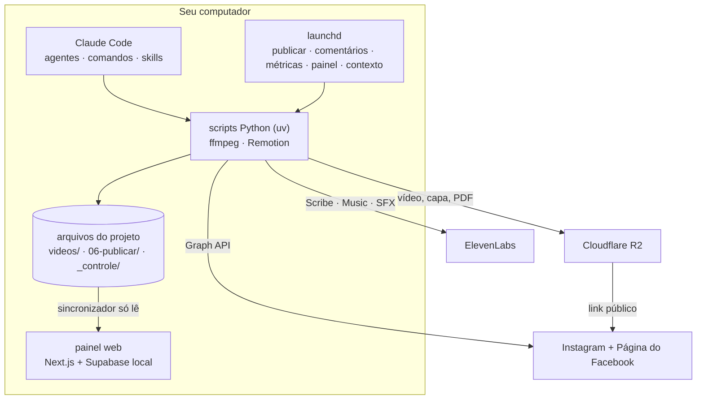

# Korvu Studio

**Um estúdio de produção de Reels com IA que roda inteiro no seu computador** — do tema à publicação no Instagram e no
Facebook, e depois a leitura das métricas, que volta para o próximo roteiro. Agentes do Claude Code fazem o trabalho;
outros agentes, os **portões**, auditam antes de qualquer coisa chegar a você. Um painel web mostra tudo numa olhada.

[Volume 1 · Estúdio](docs/estudio/README.md) · [Volume 2 · Painel](docs/painel/README.md) ·
[Como contribuir](CONTRIBUTING.md) · [Licença MIT](LICENSE)


---

## O problema

Fazer um Reel bom toma um dia: escrever o roteiro, gravar, cortar os erros, acertar a cor, legendar, fazer a capa,
publicar nas duas redes no horário certo, responder quem comentou e, cinco dias depois, entender o que funcionou. Quem
faz isso sozinho precisa de um **estúdio de edição** — e de uma equipe.

O Korvu Studio é essa equipe, em código aberto: 29 agentes com função definida, 20 comandos, 10 skills próprias e
scripts Python que fazem o trabalho pesado (ffmpeg, Remotion, API da Meta). Quem grava continua sendo uma pessoa;
o resto é automático, com duas paradas humanas: aprovar o corte e mandar o vídeo para a fila.

## O que ele faz

| Etapa | Quem faz | O que sai |
|---|---|---|
| Pauta e pesquisa | `estrategista`, `pesquisador-de-material`, `buscador-de-videos` | tema com fonte, dossiê, trechos de vídeo |
| Roteiro | `roteirista` → `dramaturgo` (naturalidade) | roteiro narrativo, teleprompter, texto para o monitor de voz |
| Material da palavra-chave | `produtor-de-material` | PDF de até 2 páginas que o direct entrega a quem comenta |
| Edição | `editor-de-video` (skill `corte-por-roteiro`) | transcreve, alinha a fala ao roteiro, escolhe o melhor take, corta erros e pausas, gera a EDL |
| Cor | `colorista` (skill `color-grading`) | V-Log → Rec.709 + look da marca, por arquivo de câmera |
| Gráficos | Remotion (skill `legendas-animadas`, `animador`) | legendas do roteiro, títulos, cenas extras, animações, zooms |
| Áudio e música | `produtor-musical` (skill `audio-polish`, ElevenLabs Music) | −14 LUFS, música com ducking sob a voz |
| Capa | `designer-de-capas` | frame parado do próprio vídeo + título |
| Imagem que falta | skill `gerar-imagem` (Gemini via OpenRouter ou OpenAI) | ilustração ou objeto gerado, com modo teste barato e registro do que foi gerado |
| QA e pacote | skill `qa-video`, `scripts/montar_pacote.py` | pacote selado em `05-render-pronto/` |
| Publicação | `publicador`, `scripts/publicar.py` (launchd) | Reel no Instagram + Facebook na hora agendada |
| Comentário → direct | `scripts/responder_comentarios.py` (launchd) | quem comenta a palavra recebe o PDF no direct |
| Métricas | `scripts/metricas.py` → `analista-de-metricas` | o que prendeu e o que fez salvar, de volta para o roteirista |

**Sem servidor e sem serviços pagos de automação** (n8n, Zapier, Make): o agendamento é o `launchd` do macOS, a fila é
uma pasta, o estado é JSON no disco. A publicação usa a Graph API da Meta direto.

## GAUNTLET — quem faz não aprova

Cada departamento tem um **portão**: um agente gerente que audita e não constrói. Nada chega a você sem o APROVADO do
portão da área; o veredicto fica preso aos arquivos (mudou o arquivo depois do APROVADO, o veredicto vence). Três voltas
bloqueadas = a decisão sobe para você. Detalhe em [`docs/gauntlet.md`](docs/gauntlet.md).

```mermaid
flowchart LR
    T([tema]) --> P[pauta e pesquisa] --> GP{{PORTÃO-PAUTA}}
    GP --> R[roteiro + PDF] --> GR{{PORTÃO-ROTEIRO}}
    GR --> G([você grava])
    G --> E[edição: EDL] --> A([você aprova o corte])
    A --> C[cor · gráficos · áudio · capa] --> GI{{PORTÃO-IMAGEM}} --> GC{{PORTÃO-CORTE}}
    GC --> PK[pacote selado] --> F([você move para a fila])
    F --> AG[publicador: legenda e agenda] --> GPub{{PORTÃO-PUBLICACAO}}
    GPub --> PB[publicar.py · IG + FB] --> M[métricas aos 5 dias] --> R
```



## O sistema



## Documentação

| Volume | O que cobre |
|---|---|
| [**Volume 1 · Estúdio**](docs/estudio/README.md) ([site](docs/estudio/site/index.html)) | o pipeline, a edição passo a passo, as 14 integrações, a API da Meta endpoint por endpoint, os jobs locais |
| [**Volume 2 · Painel**](docs/painel/README.md) ([site](docs/painel/site/index.html)) | arquitetura, banco (tabelas, migrações, RLS), sincronizador, tela por tela, design system, instalação |
| [`docs/contratos.md`](docs/contratos.md) | o formato de cada arquivo que passa de uma etapa para outra (roteiro, EDL, legendas, pacote, post) |
| [`docs/gauntlet.md`](docs/gauntlet.md) | os portões, as severidades S0/S1/S2 e o livro de veredictos |
| [`docs/decisoes.md`](docs/decisoes.md) | as decisões de método do estúdio, com o motivo de cada uma |

## Começar

Requisitos: macOS (o agendamento usa o `launchd`; o resto roda em qualquer sistema), Python 3.12 com
[`uv`](https://docs.astral.sh/uv/), Node ≥ 22, ffmpeg (com libass e zimg), [Claude Code](https://claude.com/claude-code).
Para o painel: Docker e o [Supabase CLI](https://supabase.com/docs/guides/local-development).

```bash
git clone https://github.com/<seu-usuario>/korvu-studio.git
cd korvu-studio
cp .env.example .env          # preencha só o que for usar (a ElevenLabs e a Meta são opcionais para começar)
uv sync
uv run python scripts/verificar_setup.py
```

Abra o Claude Code na pasta e peça um vídeo: `/novo-video <tema>`. Os comandos estão em `.claude/commands/`.

**Ver o painel com dados de demonstração** (nada real, tudo inventado): [`exemplos/README.md`](exemplos/README.md).

**Testes** (sem mídia e sem rede): veja [`CONTRIBUTING.md`](CONTRIBUTING.md#rodar-os-testes).

## Origem

O Korvu Studio nasceu como o estúdio privado de um criador de conteúdo sobre IA em português, que produz e publica
Reels com ele toda semana. Este repositório é a versão aberta: o método, os agentes e o código, sem os vídeos, os
roteiros, os dados de quem comentou nem as métricas do estúdio. A vitrine e a demonstração (`exemplos/`) usam só
dados inventados. As exceções, liberadas pelo autor: as capturas de tela do **Volume 2** mostram o painel do estúdio
original como ele é, e os números citados na documentação (testes, contagens, tempos) são do estúdio original.

## Licença

[MIT](LICENSE) © Korvu. As skills de terceiros (Remotion, Supabase, etc.) não estão copiadas aqui: são instaladas pelo
[`skills-lock.json`](skills-lock.json), cada uma com a sua licença. O **Remotion** tem licença própria — gratuita para
pessoas e empresas pequenas; confira em [remotion.dev/license](https://www.remotion.dev/license) antes de usar
comercialmente.
