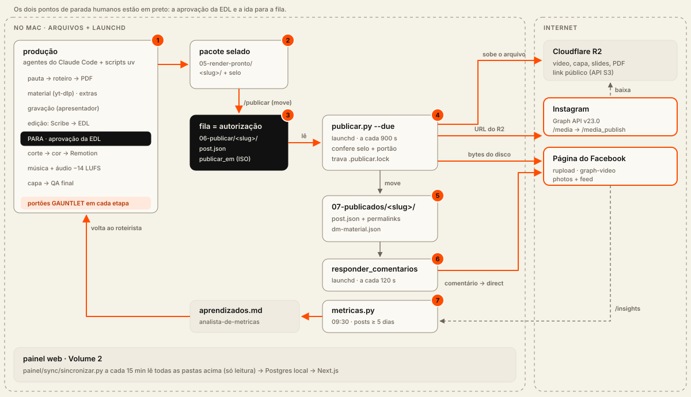
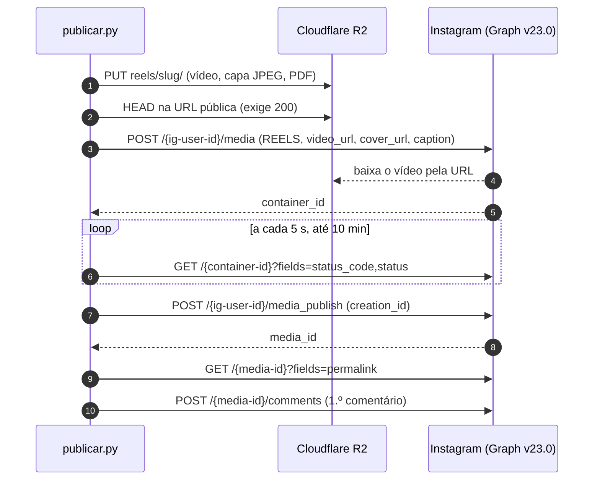
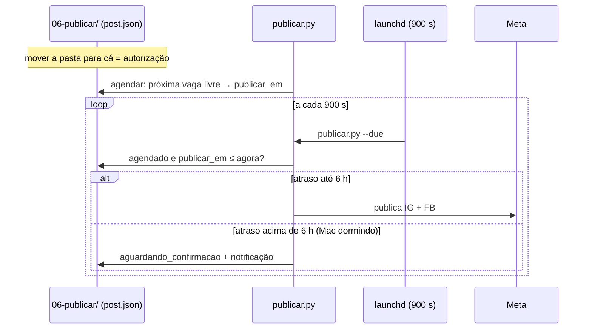
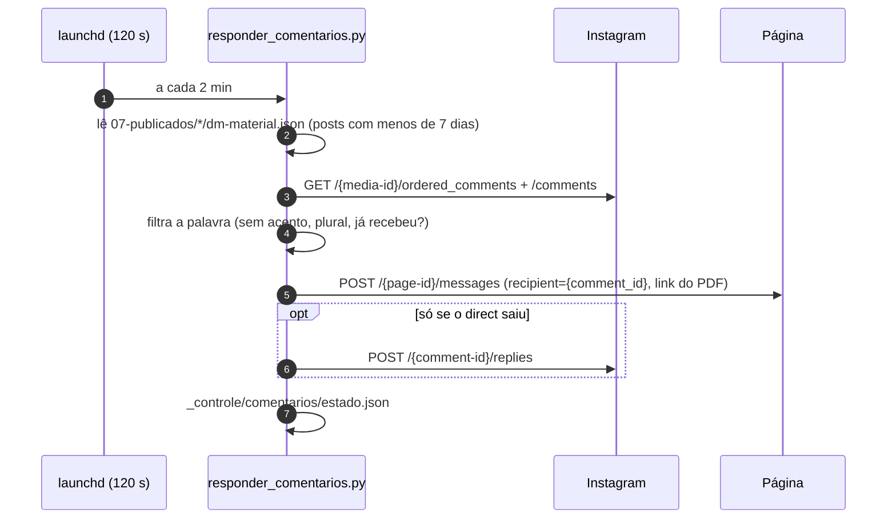
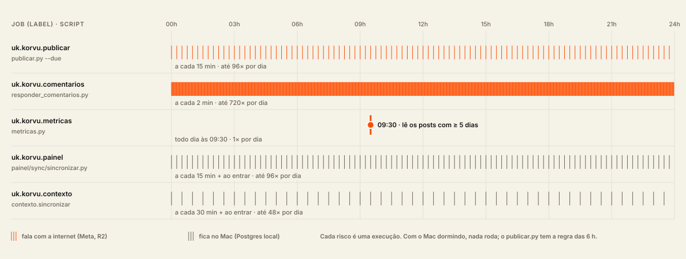
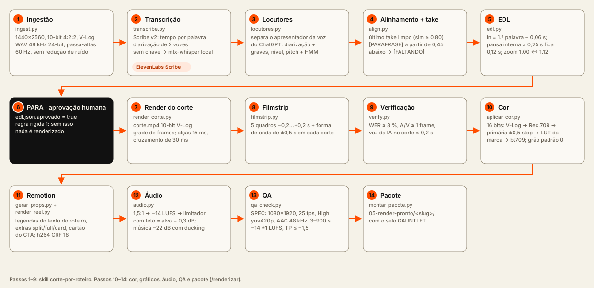
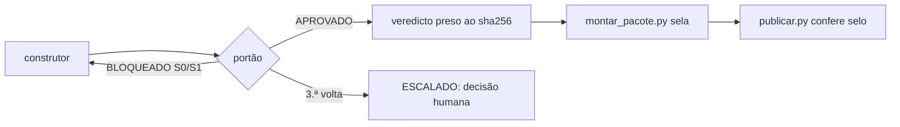
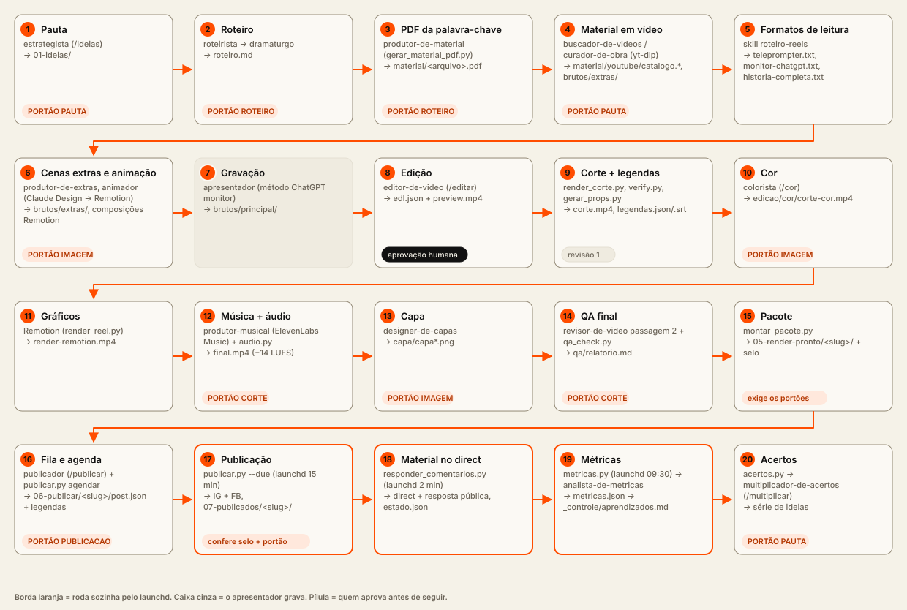

# Korvu Studio · estúdio

**Volume 1 · Estúdio** (esta página) · [Volume 2 · Painel](../painel/README.md)

Um estúdio de Reels sobre Inteligência Artificial que roda inteiro num Mac: do tema à publicação no Instagram e no
Facebook, e depois a leitura das métricas, que volta para o roteirista. Agentes do Claude Code + scripts Python (`uv`)
+ cinco jobs do `launchd`. Sem servidor, sem n8n, Zapier, Make ou ManyChat.



O detalhe completo, com os diagramas de sequência, está no site: [`site/index.html`](site/index.html).
Cada diagrama também existe como SVG solto em [`site/diagramas/`](site/diagramas/).

## Sumário
1. [Como conversa com a Meta](#1-como-conversa-com-a-meta)
2. [Automação local](#2-automação-local)
3. [Metodologia de edição](#3-metodologia-de-edição)
4. [Integrações](#4-integrações)
5. [Pipeline, agentes e portões](#5-pipeline-agentes-e-portões)
6. [Tecnologia](#6-tecnologia)
7. [Qualidade](#7-qualidade)
8. [Instalar e reusar](#8-instalar-e-reusar)

---

## 1. Como conversa com a Meta

Graph API direta (`requests`), caminho Facebook Login, `graph.facebook.com/v23.0`. O **Instagram busca o arquivo por
URL pública** no Cloudflare R2; o **Facebook recebe o arquivo do disco** ("o robô do Facebook leva 403 da Cloudflare"
no R2). A Meta não guarda o agendamento: a hora mora no `post.json`.

### Reel no Instagram



`media_publish` não é idempotente: antes de repetir, o script confere se o contêiner já está `PUBLISHED` e procura o
post pela legenda.

**Facebook:** até 90 s vira Reel da Página (`/video_reels` start → bytes em `rupload.facebook.com` → status → finish);
acima de 90 s vira vídeo da Página com upload retomável em pedaços (`graph-video.facebook.com`), porque num pedido só
"deu 413 com 171 MB". **Carrossel** (3–10 slides, JPEG): um contêiner por slide + `CAROUSEL` no IG; fotos
`published=false` + um `/feed` no FB.

### Agendamento



### Comentário → direct com o PDF



**Métricas:** todo dia às 09:30, posts com ≥ 5 dias: `GET /{media}/insights` (IG) e `GET /{video}/video_insights`
(FB) → `metricas.json` → `_controle/aprendizados.md` → roteirista. A API não dá a curva de retenção segundo a segundo.

**Permissões:** `instagram_basic`, `instagram_content_publish`, `instagram_manage_comments`,
`instagram_manage_messages`, `instagram_manage_insights`, `pages_show_list`, `pages_read_engagement`,
`pages_manage_posts`, `read_insights`, `pages_manage_engagement`.

> **O token não renova sozinho.** Token de usuário de longa duração (~60 dias) → token da Página, que "normalmente
> não expira". Não há refresh no código; `publicar.py verificar-tokens` avisa quando faltam menos de 7 dias, e o erro
> 190 indica token expirado.

## 2. Automação local

| Job | Script | Intervalo | Escreve |
|---|---|---|---|
| `uk.korvu.publicar` | `scripts/publicar.py --due` | 900 s | R2, Meta, `post.json`, `07-publicados/` |
| `uk.korvu.comentarios` | `scripts/responder_comentarios.py` | 120 s | direct + resposta, `estado.json` |
| `uk.korvu.metricas` | `scripts/metricas.py` | diário 09:30 | `metricas.json`, `_controle/metricas.md` |
| `uk.korvu.painel` | `painel/sync/sincronizar.py` | 900 s + ao entrar | Postgres local do painel |
| `uk.korvu.contexto` | `python -m contexto.sincronizar` | 1800 s + ao entrar | schema `contexto` no Postgres local |



"Em vez de a Meta avisar (webhook, que exige um endereço na internet ligado 24 h), o script **pergunta** ao Instagram
a cada 2 minutos." Com o Mac desligado nada se perde: a Meta deixa responder até 7 dias depois do comentário.
Custo escrito no projeto: API da Meta + scripts próprios "grátis, sem limite de contatos"; ElevenLabs Music exige
plano pago; R2 e Scribe sem valor documentado.

## 3. Metodologia de edição

```mermaid
flowchart LR
    A[1 Ingestão] --> B[2 Transcrição<br/>Scribe v2, 2 vozes] --> C[3 Locutores] --> D[4 Alinhamento<br/>ao roteiro] --> E[5 EDL<br/>melhor take]
    E --> F{{6 PARA<br/>aprovação humana}} --> G[7 Corte ffmpeg<br/>zoom 1.00↔1.12] --> H[8 Filmstrip] --> I[9 Verificação]
    I --> J[10 Cor] --> K[11 Remotion] --> L[12 Áudio<br/>−14 LUFS] --> M[13 QA] --> N[14 Pacote]
```



O áudio da gravação tem duas vozes (o ChatGPT Voz lê a linha, o apresentador repete); o corte usa só a dele, e a voz
da IA é zona proibida. Take escolhido = o último limpo (similaridade ≥ 0,80); [PARAFRASE] a partir de 0,45.

Regras de corte (constantes do `edl.py`): `in` = 1.ª palavra − 0,06 s; `out` = última palavra + 0,08 / 0,45 / 0,75 s
(normal / pausa / pausa longa); pausa interna > 0,25 s fica 0,12 s; o corte nunca entra na energia de uma palavra.
Cor (16 bits): V-Log → Rec.709 → primária por take (±0,5 stop) → LUT da marca → bt709, grão padrão 0. Áudio:
compressor 1,5:1 → −14 LUFS → limitador com teto = alvo de true peak (−1,5 dBTP) − 0,3 dB → AAC 256k. QA pelo `SPEC`
do `qa_check.py` (1080×1920, 25 fps, H.264 High, AAC 48 kHz, 3–900 s, −14 ±1 LUFS).



## 4. Integrações

| Integração | Para quê | Credencial (nome) |
|---|---|---|
| Meta Graph API | publicar, comentários, direct, métricas, perfil | `INSTAGRAM_*`, `META_*` |
| Cloudflare R2 | link público de vídeo, capa, slides e PDF | `R2_*` |
| ElevenLabs Scribe v2 | transcrição com tempo por palavra + 2 vozes | `ELEVENLABS_API_KEY` |
| ElevenLabs Music | trilha instrumental original | `ELEVENLABS_API_KEY` |
| ElevenLabs Sound Effects | efeitos do sound design | `ELEVENLABS_API_KEY` |
| YouTube (**yt-dlp**) | buscar, baixar e cortar vídeos | nenhuma |
| archive.org + Wikimedia Commons | B-roll com licença legível por máquina | nenhuma |
| Anthropic / Claude Code | todos os agentes e portões | a do Claude Code |
| Claude Design | animações explicativas (manual) | — |
| DaVinci Resolve | ajuste fino manual (FCPXML + MCP) | — |
| Google Fonts | fontes do PDF e do carrossel | nenhuma |
| Groq / OpenAI Whisper | reserva da skill `watch` | não confirmado |
| Geração de imagem ⚠ não verificada com chamada real | imagem que não existe e não tem material livre (motores `teste`, `gemini` = Gemini 3.1 Flash Image via OpenRouter, `openai` = gpt-image-2) | `OPENROUTER_API_KEY`, `OPENAI_API_KEY` |
| Hugging Face | modelo de embedding do índice de contexto | nenhuma |

São 14 integrações. A ElevenLabs não baixa vídeo: quem baixa do YouTube é o `yt-dlp`. A geração de imagem só foi
testada em modo `--seco` (sem chave, sem rede); cada imagem gerada fica registrada em `imagens-geradas.jsonl`.
**Geração de vídeo por IA: ainda não integrada.**

## 5. Pipeline, agentes e portões

**Quem faz não aprova.** Cada departamento tem um portão que audita e não constrói; o veredicto fica preso ao sha256
dos arquivos que ele viu.





Portões: PAUTA (`portao-pauta`) · ROTEIRO (`revisor-de-roteiro`) · IMAGEM (`portao-imagem`) · CORTE
(`revisor-de-video`, passagem 2) · PUBLICACAO (`portao-publicacao`). 22 agentes, todos `model: opus`.

## 6. Tecnologia

Python ≥ 3.12 · uv 0.12.14 · requests 2.34.2 · boto3 1.43.94 · elevenlabs 2.68.0 · mlx-whisper 0.4.3 ·
Pillow 12.3.0 / OpenCV 4.14.0.94 · numpy 2.5.3 / scipy 1.18.1 · rapidfuzz 3.14.6 · Remotion 4.0.525 / React 19.2.3 /
TypeScript 5.9.3 · yt-dlp 2026.08.19 · ffmpeg estático · Chrome headless · launchd · Claude Code · DaVinci Resolve.

## 7. Qualidade

| Teste | Resultado |
|---|---|
| publicação | 112/116 (as 4 falhas esperam as vagas antigas do calendário) |
| comentários | 33/33 |
| métricas | 32/32 |
| portões | 64/64 |

Em produção: 16 publicações entre 13/10 e 11/11/2026 (15 Reels e 1 carrossel); os 5 jobs carregados.

## 8. Instalar e reusar

```bash
uv sync
cd remotion && npm install && cd ..
cp .env.example .env                                  # preencher; nunca versionar
uv run python scripts/verificar_setup.py
uv run python scripts/publicar.py verificar-tokens    # não publica nada
uv run python scripts/publicar.py --due --dry-run     # ensaio sem rede
bash scripts/launchd/instalar.sh
uv run python scripts/publicar.py publicar <slug> --sim
```

Para usar fora do Korvu Studio, troque: as pastas e o contrato do `post.json` (`docs/contratos.md`), o selo GAUNTLET
(`validar_pacote`), as vagas e o fuso (`_controle/calendario.md`), os textos do direct (`automacao-meta/respostas.yaml`),
os labels `uk.korvu.*` (`scripts/launchd/`), a câmera e o LUT (`FPS_PROJETO`, `00-marca/cor/luts/`) e o idioma da
transcrição (`language_code` em `transcribe.py`). O detalhe está no [site](site/index.html#instalar).
