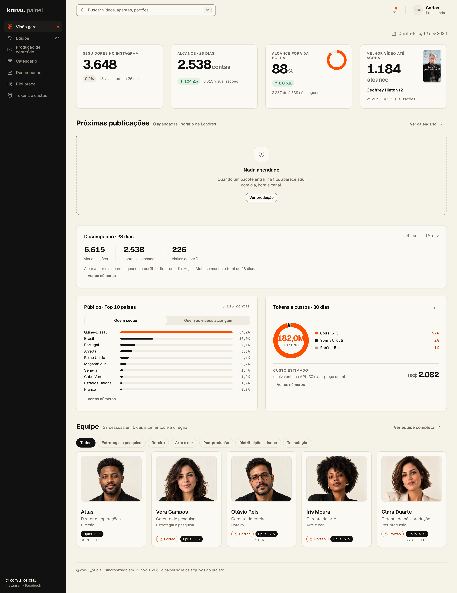
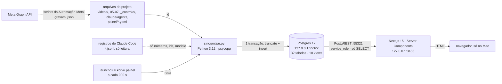
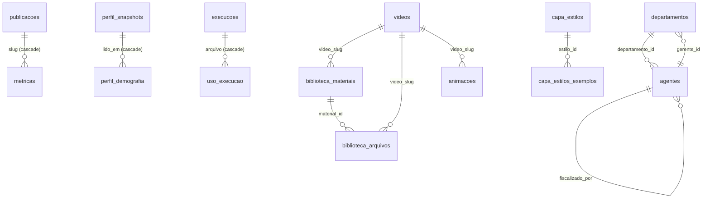
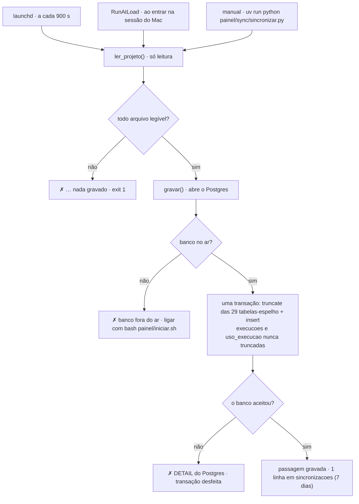

# korvu. painel

[Volume 1 · Estúdio](../estudio/README.md) · **Volume 2 · Painel** (esta página)

O quadro de comando do estúdio de Reels **Korvu Studio**: um site que roda no próprio Mac e mostra, numa olhada, a equipe
de agentes de IA, a fase de cada vídeo, os portões de aprovação (o GAUNTLET), a fila de publicação, o desempenho no
Instagram e no Facebook e quanto a IA consome em tokens e dólares. **Ele só lê os arquivos do projeto**: não cria, não
edita e não publica nada.



**9 telas · 32 tabelas · 10 views · 18 migrações · 7 APIs.** A documentação visual completa (diagramas, tela por tela,
design system) está em [`site/index.html`](site/index.html); os diagramas soltos, em [`site/diagramas/`](site/diagramas/).

## Sumário

1. [Arquitetura](#arquitetura)
2. [Tecnologia](#tecnologia)
3. [Banco de dados](#banco-de-dados)
4. [Back-end e sincronização](#back-end-e-sincronização)
5. [APIs](#apis)
6. [Tela por tela](#tela-por-tela)
7. [Design system](#design-system)
8. [Qualidade](#qualidade)
9. [Instalar e reusar](#instalar-e-reusar)

## Arquitetura

Arquivos do projeto → sincronizador → Postgres → Next.js → navegador. Tudo em `127.0.0.1`.



**O caminho de um dado (o veredicto de um portão até a tela):** o `scripts/portoes.py` grava o veredicto no
`portoes.json` do alvo → a cada 15 min o launchd roda `sincronizar.py` → ele importa `portoes.py` com
`SO_LEITURA = True` → numa transação, `truncate` + `insert` em `portoes_estado` e `veredictos` → o Next.js lê pela API do
Supabase, páginas de 1.000 linhas com contagem exata → a tela Produção, a ficha do agente e o sino de avisos mostram →
o rodapé diz a hora da última passagem (`sincronizacoes.em`).

## Tecnologia

| Camada | Tecnologia | Versão |
|---|---|---|
| Web | Next.js (App Router) · React · TypeScript `strict` · Tailwind CSS | 15.5.28 · 19.1.10 · 5.9.3 · 4.3.3 |
| Banco no app | `@supabase/supabase-js` (só no servidor, com `server-only` 0.0.1) | 2.58.0 |
| Lint | ESLint + `eslint-config-next` | 9.39.5 / 15.5.28 |
| Banco | Supabase local (CLI), Postgres | Postgres 17 |
| Sincronizador | Python · psycopg (binary) · PyYAML, com `uv` | ≥ 3.12 · ≥ 3.2 · ≥ 6.0.3 |
| Agendador | launchd (macOS), a cada 15 min | — |
| Docker | Colima | — |
| Prévias dos looks | ffmpeg | — |
| Capturas de tela | Chrome sem janela via CDP + Node | Node ≥ 22 |
| Fontes | Geist e Geist Mono (OFL 1.1), locais | — |

## Banco de dados

Supabase local próprio (`project_id = "korvu-studio-painel"`): app 3456, API 55321, Postgres 55322, shadow 55320, Studio
55323 desligado. **32 tabelas e 10 views** em 18 migrações (`painel/supabase/migrations/`). As tabelas-espelho são
refeitas a cada passagem; `execucoes` e `uso_execucao` são arquivo e nunca são truncadas. O custo não fica nas linhas:
as views calculam a partir de `precos_modelo`.



Sem chave estrangeira: `portoes_estado`, `veredictos`, `prontos` e `fila` (ligadas a `videos` só pela lógica),
`nao_publicar`, `calendario_vagas`, `perfil_diario`, `sincronizacoes`, `precos_modelo`, `cambio`,
`biblioteca_referencias`, `biblioteca_mais_utilizados`, `looks`, `capa_estilos`, `legenda_estilos`, `fontes`,
`sistema_ferramentas`, `modelos_descricao`, `sistema_contagens`. Views (`security_invoker = true`): `consumo`,
`consumo_diario`, `execucoes_custo`, `biblioteca_materiais_resumo`, `biblioteca_por_tipo`, `biblioteca_por_video`,
`videos_producao`, `modelo_por_agente`, `armazenamento`, `sistema_modelos`.

**Segurança:** RLS ligado em todas as tabelas, sem nenhuma política. `postgres` (o sincronizador) escreve;
`service_role` (o app, só no servidor) só lê; `anon` e `authenticated` não têm nenhum privilégio, inclusive em objetos
criados depois (`20261022225715_revogar_privilegios_da_api`). Não há login no app. Tudo só em `127.0.0.1`.

**Migrações:** 22/10 (3: inicial, leitura do app, revogar privilégios) · 23/10 (8: tokens e custos, cache por TTL,
câmbio, fila, fases, gravação, FKs, biblioteca) · 24/10 (5: produção/calendário/desempenho, gravação no Mac e no HD,
modelo por agente, acervo de estilos, rosto do look) · 25/10 (2: frase dos looks, HD fora do painel).

## Back-end e sincronização

`painel/sync/sincronizar.py` lê o projeto e regrava o espelho do banco. **Nunca escreve** em `videos/`, `00-marca/`,
`_controle/`, `scripts/` nem nos registros do Claude Code; brutos e materiais só por listagem e `stat()`.



Em todo erro, o painel continua com a passagem anterior. `--seco` lê sem gravar. O único passo que grava arquivo é
`painel/sync/previas_looks.py` (ffmpeg + LUTs → `painel/previas/looks/*.jpg`).

## APIs

| API | Quem chama | O que traz | Onde guarda |
|---|---|---|---|
| Supabase / PostgREST (127.0.0.1:55321) | app Next.js, só no servidor | 32 tabelas e 10 views, só SELECT | — |
| Postgres direto (psycopg, 127.0.0.1:55322) | sincronizador | — (escreve) | banco do painel |
| Meta Graph API v23.0, **indireta** | `scripts/metricas.py`, `perfil.py`, `publicar.py` (área Automação Meta) | métricas, perfil, demografia, permalinks | `07-publicados/*.json`, `_controle/perfil/*.json` → `metricas`, `publicacoes`, `perfil_*` |
| Registros do Claude Code (`.jsonl`) | sincronizador | usage, modelo, id, timestamp | `execucoes`, `uso_execucao` |
| Preço de tabela da API da Anthropic (copiado no código) | — | US$ por milhão de tokens | `precos_modelo` |
| `scripts/portoes.py` (Python interno) | sincronizador, só leitura | portões, veredictos, `conferir_pacote` | `portoes_estado`, `veredictos`, `fila.erros_gauntlet` |
| Rotas do app | navegador | `GET /capa/[pasta]/[slug]` (PNG), `GET /look/[id]` (JPEG) | — |

## Tela por tela

| Tela | Rota | A pergunta que ela responde | Capturas |
|---|---|---|---|
| Visão geral | `/` | Como está o estúdio hoje: perfil, próximas publicações, últimos 28 dias, consumo de IA e equipe. | [1440](site/capturas/inicio-1440.png) · [375](site/capturas/inicio-375.png) |
| Equipe | `/equipe` | Quem é quem por departamento, quem é portão, com que modelo trabalha e quanto consumiu em 30 dias. | [1440](site/capturas/equipe-1440.png) · [375](site/capturas/equipe-375.png) |
| Ficha do agente | `/equipe/[id]` | O que essa pessoa faz e, se for portão, o que passou por ela. | [1440](site/capturas/equipe-portao-imagem-1440.png) · [375](site/capturas/equipe-portao-imagem-375.png) |
| Contratar | `/equipe/contratar` | Como pedir um agente novo já ligado ao portão do departamento. | [1440](site/capturas/equipe-contratar-1440.png) · [375](site/capturas/equipe-contratar-375.png) |
| Produção de conteúdo | `/producao` | Em que fase está cada conteúdo e o que precisa de atenção. | [1440](site/capturas/producao-1440.png) · [375](site/capturas/producao-375.png) |
| Calendário | `/calendario` | O que sai em cada dia, onde, as vagas livres e se cada post da fila vai sair. | [1440](site/capturas/calendario-1440.png) · [375](site/capturas/calendario-375.png) |
| Desempenho | `/desempenho` | O que cresce, quem os vídeos alcançam e qual conteúdo funciona. | [1440](site/capturas/desempenho-1440.png) · [375](site/capturas/desempenho-375.png) |
| Biblioteca | `/biblioteca` | Escolher o estilo do próximo vídeo e ver quanto espaço o estúdio ocupa e o que o faz rodar. | [1440](site/capturas/biblioteca-1440.png) · [375](site/capturas/biblioteca-375.png) |
| Tokens e custos | `/tokens` | Quanto a operação de IA consome, onde, quem e quanto custa em dólar (preço de tabela da API). | [1440](site/capturas/tokens-1440.png) · [375](site/capturas/tokens-375.png) |

Os blocos numerados de cada tela e a tabela de onde vem cada dado estão no [site](site/index.html#telas).

## Design system

**"korvu. painel"**, desenhado no Claude Design em 23/10/2026 e copiado sem mudar para `painel/web/src/app/design/`.
Um tema só, claro ("Marfim"): fundo `#F5F2E8`, tinta `#111111`, barra lateral `#111111`, acento `#FF4D00`. Geist e Geist
Mono locais, números tabulares em tudo. 48 componentes em `painel/web/src/components/`. Movimento em três versões
(estados; toque, popovers e gaveta; os dados entram), tudo respeitando `prefers-reduced-motion`.

## Qualidade

**GAUNTLET:** quem faz não aprova. Em 12/11: área **design** aprovada (04/11), **interface** aprovada (04/11), **dados**
vencida (último APROVADO em 25/10; depois mudou o `painel/equipe.yaml`).

| Teste | Resultado em 12/11 |
|---|---|
| `test_previas_looks.py` | **44/44 PASS** |
| `test_biblioteca_yaml.py` | **19/22 PASS · 3 FAIL**: fonte "Inter Tight" não bate com o `brand.ts`; 4 briefs de animação (E24, E26, E27, E28) sem duração; por causa dessas duas, "nenhum aviso ⚠" falha |
| `test_sincronizar.py` | **não rodado** (aplica as migrações num banco de teste) |

Os testes são scripts Python, não pytest: `uv run pytest painel/tests -q` não roda (o pytest não está no
`pyproject.toml`).

## Instalar e reusar

Pré-requisitos: macOS, Docker (Colima), Supabase CLI, Node ≥ 22 e npm, Python ≥ 3.12 com `uv`, Chrome (capturas) e
ffmpeg (prévias). Na raiz do projeto:

```bash
uv sync
cd painel/web && npm ci && cd ../..
bash painel/iniciar.sh            # banco + primeira sincronização + app em http://localhost:3456
```

> Use sempre `bash painel/iniciar.sh`, **nunca um `supabase start` solto** (ele pode recriar a rede Docker aberta para
> a rede local). A tela de erro do app ainda sugere `cd painel && supabase start`; ignore.

Crie `painel/web/.env.local` com `SUPABASE_URL=<API URL local>` e `SUPABASE_SERVICE_ROLE_KEY=<service_role do supabase status>`
(passo deduzido do código, não confirmado). Depois:

```bash
bash scripts/launchd/instalar.sh uk.korvu.painel          # sincroniza a cada 15 min
launchctl kickstart -k gui/$(id -u)/uk.korvu.painel        # forçar agora
uv run python painel/tests/test_previas_looks.py           # e os outros dois testes
```

**Para usar fora do Korvu Studio:** reescrever as funções de leitura do `sincronizar.py` (presas às pastas do estúdio e a
`docs/contratos.md`); trazer ou substituir o `scripts/portoes.py` (sem ele o sincronizador não abre); trocar
`painel/equipe.yaml`, `biblioteca.yaml`, `cambio.yaml`, os retratos e os textos fixos; ajustar `PAINEL_PROJETO`,
`PAINEL_DB_URL`, `PAINEL_REGISTROS`, `PRECOS` e o fuso de publicação. Reusa-se quase sem mudança o padrão
"arquivos → sincronizador em transação → Postgres com RLS fechado → Server Components com paginação conferida", o design
system, os componentes e o `capturar.sh`.

**Antes de expor na internet:** trocar as chaves de demonstração do Supabase, criar um projeto na nuvem
(`supabase db push`), trocar o `web/.env.local` e pôr login.
